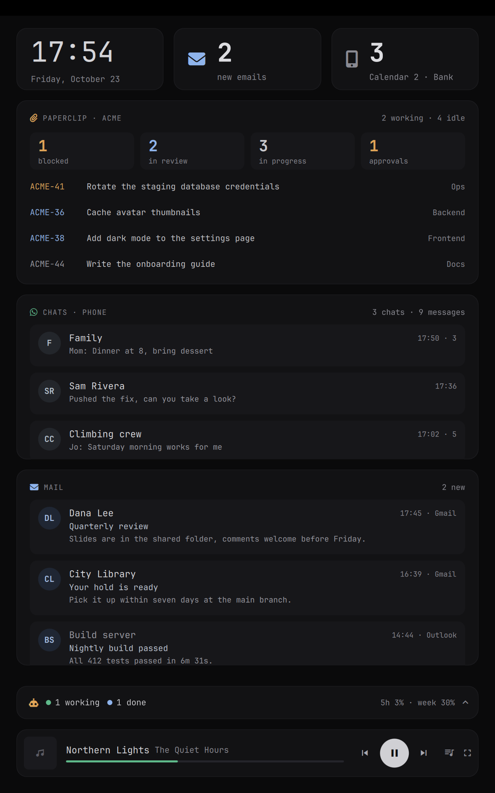

# omarchy-companion-display

An always-on companion display for a secondary monitor on [Omarchy](https://omarchy.org/), built for a vertical screen.

It turns a spare screen into a quiet, glanceable dashboard. Every section is optional, and the ones that need something you don't have hide themselves.

<p align="center"></p>

| Section | Needs | Shows |
|---|---|---|
| Clock | – | Time and date |
| Mail | A mail client that posts desktop notifications, and/or a mail app on your phone | New-mail counter and the latest mails with sender, subject and preview |
| Phone notifications | [KDE Connect](https://kdeconnect.kde.org/) paired with your phone | Total count per app |
| Chats | KDE Connect | WhatsApp, Telegram, Signal… grouped by chat with the latest message |
| Paperclip | A [Paperclip](https://github.com/paperclipai/paperclip) instance and a board API key | Task counts, agent availability, latest blocked and in-review tasks |
| Claude Code | [Claude Code](https://claude.com/claude-code) | Sessions working, done, waiting or idle, plus usage limits |
| Player | Any MPRIS player (Spotify, browsers, your phone through KDE Connect) | Now playing with controls |

Burn-in care is built in: a dark palette with no white areas, a slow pixel shift, an idle mode (pure black with a small dim block that moves around), and an option to cover the Omarchy bar on that monitor.

> **Provided as is.** This is a personal project shared in case it is useful. Issues and pull requests are welcome, but there is no promise of support or of keeping up with every Omarchy release.

## Requirements

- Omarchy with the Quickshell-based shell (plugin support)
- Python 3 with PyGObject (ships with Omarchy)
- Optional: `kdeconnect` paired with your phone, Claude Code, a Paperclip instance

## Install

```bash
omarchy plugin add https://github.com/apuyana/omarchy-companion-display.git --enable
cp ~/.config/omarchy/plugins/apuyana.companion-display/config.example.json ~/.config/omarchy/companion-display.json
```

Then set `screen` in `~/.config/omarchy/companion-display.json` to the monitor you want (`hyprctl monitors` lists them). The config reloads on save.

The panel sits on the Bottom layer of that monitor, so windows you open there still cover it.

## Using it

- **Mail counter or mail section**: opens your default mail client and marks every mail as seen.
- **Chats section**: opens your chat app (WhatsApp web by default).
- **A chat or a mail**: hover it and press ✕ to dismiss it. Phone notifications are dismissed on the phone too.
- **Paperclip task**: opens it in the browser.
- **Claude bar**: the icon opens Claude Desktop; the rest of the bar expands the list of every session.
- **Player bar**: the buttons control playback, the expand button switches to a full player, and the rest of the bar opens your player app (Spotify by default).
- **Lyrics**: the lyrics button (lines with a music note) opens a lyrics panel above the player bar (about a third of the screen), or shows them in place of the album art in the full player. Synced lyrics follow the song. Live and remastered versions fall back to the plain song title; live versions show unsynced lyrics, since studio timings drift. If the service is down, the panel tries again every minute. They come from [LRCLIB](https://lrclib.net), a free lyrics database that needs no account, are fetched only while the panel is open, and are cached under `~/.cache/omarchy-companion-display/lyrics`.

**Idle mode** starts after `idleSeconds` without news or mouse movement over the panel. It wakes up on a new chat, mail or phone notification, when Claude Code finishes its last working session, or when you move the mouse over it.

## Configuration

`~/.config/omarchy/companion-display.json`:

| Key | Default | What it does |
|---|---|---|
| `screen` | `HDMI-A-1` | Monitor to draw on |
| `locale` | `en_US` | Locale for the date |
| `dateFormat` | `dddd, MMMM d` | Qt date format under the clock |
| `idleSeconds` | `300` | Seconds without news before idle mode |
| `privacy` | `false` | Hide message and mail text and Paperclip task titles; show only senders, task ids and counts |
| `demo` | `false` | Show made-up data instead of yours, for screenshots or to try the panel out |
| `hideBar` | `false` | Cover the Omarchy bar on this monitor with a black strip |
| `chatApps` | WhatsApp, Telegram, Signal… | Phone apps shown as chats |
| `mailApps` | your default mail client | Desktop apps whose notifications count as mail |
| `phoneMailApps` | Outlook, Gmail, BlueMail | Phone apps whose notifications count as mail |
| `ignoreApps` | `[]` | Phone apps to leave out |
| `mailHistory` | `30` | Desktop mails kept |
| `launch` | see below | Command run when clicking `mail`, `chats`, `claude` or `player`; `[]` disables the click |
| `paperclip` | `{}` | Paperclip instance, see below |
| `claude.expanded` | `false` | Start with the Claude session list open |
| `claude.doneMinutes` | `15` | Minutes a finished session shows as "done" before it turns idle |
| `modules` | all `true` | Turn sections off: `clock`, `mail`, `apps`, `chats`, `paperclip`, `claude`, `player` |

### Turning sections off

Sections hide on their own when their source is missing: chats and phone notifications without a paired KDE Connect device, Paperclip without a `paperclip.url`, Claude without any Claude Code sessions or usage data. To hide a section you could use but don't want, set it to `false` under `modules`:

```json
"modules": { "paperclip": false, "claude": false }
```

### Mail

Mail is read from notifications, so no mail credentials are needed. The client has to show desktop notifications for new mail.

By default the panel uses your system default mail client (the `mailto:` handler, see `xdg-mime query default x-scheme-handler/mailto`): its notifications count as mail, and clicking the mail section opens it, or focuses it if it is already open. To use something else, set the notification app names and the command yourself:

```json
"mailApps": ["Thunderbird"],
"launch": { "mail": ["omarchy-launch-or-focus", "thunderbird", "thunderbird"] }
```

Phone mail apps are matched by `phoneMailApps`.

### Click commands

`launch` maps each clickable section to a command. Defaults: `mail` opens the default mail client, `chats` opens WhatsApp web, `player` opens Spotify, `claude` opens Claude Desktop. `bin/open-default-app <mime-type>` opens or focuses the default app for any MIME type, for example `x-scheme-handler/http` for the browser.

### Paperclip

The section is off in the example config. Turn it on with `"modules": { "paperclip": true }` and add your instance:

```json
"paperclip": {
  "url": "https://paperclip.example.com",
  "companyId": "<company uuid>",
  "name": "My Company",
  "interval": 60,
  "maxIssues": 4
}
```

It needs a board API key in `~/.config/omarchy/companion-display-paperclip.token`. If the Paperclip CLI is logged in (`paperclipai auth login`), create one with:

```bash
~/.config/omarchy/plugins/apuyana.companion-display/bin/paperclip-create-key https://paperclip.example.com
```

The key is named `companion-display`, expires in a year by default, and is never printed. The panel only reads from Paperclip, but a board key carries your full board permissions, so keep the file private.

### Phone shows "Sensitive notification content hidden"

Android hides the content of some notifications from KDE Connect. On the phone, allow sensitive notification content (Settings › Notifications, or the app's own notification settings) to see senders and text.

## How it works

`bin/companion-feed` is a small Python process that reads KDE Connect over D-Bus, listens to desktop `Notify` calls for mail apps, watches Claude Code's session files in `~/.claude/sessions`, polls Paperclip, and prints the combined state as JSON lines. `Panel.qml` runs it and draws the panel; it reads MPRIS and Omarchy's Claude usage record (`~/.local/state/omarchy/agents/usage/claude.json`) directly. Mail state lives in `~/.local/state/omarchy-companion-display/`.

## Uninstall

```bash
omarchy plugin remove apuyana.companion-display
```

This removes the plugin but keeps your settings and data. To delete them too:

```bash
rm -f ~/.config/omarchy/companion-display.json ~/.config/omarchy/companion-display-paperclip.token
rm -rf ~/.local/state/omarchy-companion-display ~/.cache/omarchy-companion-display
```

## Development

Link your checkout instead of installing:

```bash
ln -s ~/path/to/omarchy-companion-display ~/.config/omarchy/plugins/apuyana.companion-display
omarchy-shell shell rescanPlugins && omarchy plugin enable apuyana.companion-display
```

QML changes need `omarchy restart shell`, because the panel stays loaded.

## License

[MIT](LICENSE)
